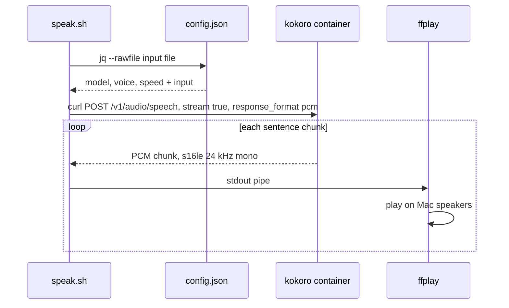

# tts

Read a local text file aloud on macOS. A Docker container runs [Kokoro-82M](https://github.com/remsky/Kokoro-FastAPI) (free, Apache 2.0). The Mac plays the audio while the container still synthesises it.



1. [speak.sh](./speak.sh): builds the request body, then pipes the audio stream
2. [config.json](./config.json): user settings
3. [kokoro container](./compose.yaml): TTS (Text-To-Speech) server on port 8880

Dashed arrows are responses. Docker on macOS has no access to the speakers, so the Mac plays the audio.

## Prerequisites

1. Docker
2. `brew install ffmpeg` (provides `ffplay`)
3. `jq` (ships with recent macOS at `/usr/bin/jq`; else `brew install jq`)

## Start

```sh
docker compose up -d
```

The container restarts with Docker. The first start downloads the image and loads the model.

## Usage

```sh
./speak.sh path/to/file.txt
```

Press `Ctrl+C` to stop.

### Alias

Run once from this folder to add a `tts` alias to zsh:

```sh
echo "alias tts='$PWD/speak.sh'" >> ~/.zshrc && source ~/.zshrc
```

Then, from any folder:

```sh
tts ~/path/file.md
```

## Settings

Edit `config.json`. Changes apply on the next run, no restart.

| Key | Default | Meaning |
|---|---|---|
| `url` | `http://localhost:8880/v1/audio/speech` | Container endpoint |
| `model` | `kokoro` | Model name |
| `voice` | `af_heart` | Voice name; mix with `af_bella(2)+af_sky(1)` |
| `speed` | `1.0` | Speech rate; above `1.2` loses clarity |

List all voices:

```sh
curl -s localhost:8880/v1/audio/voices | jq
```

Female English voices start with `af_` (American) or `bf_` (British).

## Stop

```sh
docker compose down
```

## License

[MIT](LICENSE)
